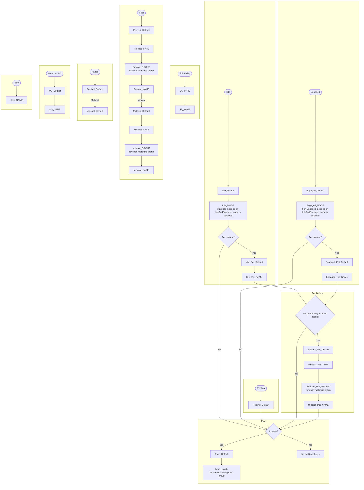

# MiniSwap

_MiniSwap_ is a [LuAshitacast][] engine for those allergic to Lua.  
Its simplicity comes at a cost though, there's no fancy automatic Treasure Hunter tagging or Haste calculation.

> [!IMPORTANT]
>
> This is not maintained anymore because you're probably better off using [DLAC][].  
> It basically achieve the same goal of allowing gear swapping with as little Lua as possible, which is actually none at all!

> [!IMPORTANT]
>
> 1. I used to mostly play on [CatsEyeXI][], there could be some incompatibilities if you are playing on a different server.
> 2. I do not play all the jobs, so it might be missing a few key things for some jobs.
> 3. Although I did not have any issue so far, it might not be the most performant code around, both for gear processing and GUI (which use imgui, probably overkill for this use case but easier to code).

Thanks to Thorny for the amazing [LuAshitacast][], and [Jyouya][] and [avogadro-war][] for publishing their own lua and providing some inspiration.

[LuAshitacast]: https://github.com/ThornyFFXI/LuAshitacast
[DLAC]: https://github.com/henkpoa/dlac
[CatsEyeXI]: https://www.catseyexi.com/
[Jyouya]: https://github.com/Jyouya/Ashita-Stuff/tree/master/config/addons/luashitacast
[avogadro-war]: https://github.com/avogadro-war/ashita_profiles

## Getting Started

1. Download `miniswap.lua` file from the [last release](https://github.com/Azu-XI/miniswap/releases/latest/)
2. Copy the file to your `ashita/config/addons/LuAshitacast/common/` folder.
3. In game, use `/lac newlua` to create a profile for your job.
4. Locate the newly created file, it should be under `ashita/config/addons/LuAshitacast/YourName_00000/JOB.lua` where `00000` is your character ID and `JOB` the job you were on.
5. Replace the content of the file with the following:

```lua
local profile = gFunc.LoadFile('common/miniswap.lua');

local aliases = {
  -- Add your job specific aliases
};

local bindings = {
  -- Add your job specific bindings
};

local modes = {
  -- Add your job specific modes
};

local sets = {
  -- Add your job specific gear sets
};

profile.Aliases = aliases;
profile.Bindings = bindings;
profile.Modes = modes;
profile.Sets = sets;
return profile;
```

## Aliases

In your job profile, add aliases like so:

```lua
local aliases = {
  ["/locklv"] = "/lac fwd locklv",
};
```

## Bindings

In your job profile, add bindings like so:

```lua
local bindings = {
  ["^y"] = "/poke",
};
```

## Gear Sets

There's no fancy lua function to write to swap gear. Simply declare sets with a specific name and it will be used automatically.

### How to declare a set

#### In game

1. Use `/lac disable` to temporarily disable swapping functionality.
2. Equip your items manually.
3. Use `/lac addset SetName` to have it saved to your lua file.
4. Repeat steps 1 to 3.

#### Manually

Within the curly brackets of the `sets` variable, write your sets as follow:

```lua
local sets = {
  SetName = {
    Main  = 'Lathi',
    Sub   = 'Enki Strap',
    Ammo  = 'Staunch Tathlum +1',
    Head  = 'Befouled Crown',
    Neck  = 'Loricate Torque +1',
    Ear1  = 'Hearty Earring',
    Ear2  = 'Etiolation Earring',
    Body  = 'Amalric Doublet +1',
    Hands = 'Amalric Gages +1',
    Ring1 = 'Defending Ring',
    Ring2 = 'Shneddick Ring',
    Back  = 'Moonlight Cape',
    Waist = 'Fucho-no-Obi',
    Legs  = { Name = 'Psycloth Lappas', AugPath='D' },
    Feet  = { Name = 'Merlinic Crackows', Augment = { [1] = '"Fast Cast"+7', [2] = 'MND+10' } },
  },
};
```

> [!NOTE]
>
> - Each slot is optional
> - As shown on the `Legs` and `Feet` slots, multiple versions of augmented gears can be distinguished with `AugPath` and `Augment`.

### Expected set names

- **Stances**

  - `Engaged_Default`
  - `Engaged_MODE`, where `MODE` is the selected mode (see [Modes](#modes)).
  - `Engaged_Pet_Default`, only when a pet is charmed/summoned.
  - `Engaged_Pet_NAME`, only when a pet is charmed/summoned, where `NAME` is the name of the Pet without spaces or any special characters, for example `Cait Sith` is `CaitSith`.
  - `Idle_Default`
  - `Idle_MODE`, where `MODE` is the selected mode (see [Modes](#modes)).
  - `Idle_Pet_Default`, only when a pet is charmed/summoned.
  - `Idle_Pet_NAME`, only when a pet is charmed/summoned, where `NAME` is the name of the Pet without spaces or any special characters, for example `Cait Sith` is `CaitSith`.
  - `IdleAndEngaged` shares a mode between both stances, using `Idle_MODE` when idle and `Engaged_MODE` when engaged (see [Modes](#modes)).
  - `Resting_Default`

- **Job Abilities**

  - `JA_TYPE`, where `TYPE` is one of `BloodPactRage`, `BloodPactWard`, `CorsairRoll`, `QuickDraw`, `Ready`, `RuneEnchantment`.
  - `JA_NAME`, where `NAME` is the name of the Job Ability without spaces or any special characters, for example `Curing Waltz III` is `CuringWaltzIII` and `Avatar's Favor` is `AvatarsFavor`.

- **Precast**

  - `Precast_Default`
  - `Precast_TYPE`, where `TYPE` is one of `BlueMagic`, `DarkMagic`, `DivineMagic`, `ElementalMagic`, `EnfeeblingMagic`, `EnhancingMagic`, `Geomancy`, `HealingMagic`, `Ninjutsu`, `Singing`, `Summoning`.
  - `Precast_GROUP`, where group is one of:

    <details>
    <summary>see group names</summary>

    https://github.com/Azu-XI/miniswap/blob/f1298cebc06e535a745d0651882163e0047298a1/common/miniswap.lua#L516-L1168

    </details>

  - `Precast_NAME`, where `NAME` is the name of the Spell without spaces or any special characters, for example `Indi-Regen` is `IndiRegen` and `Cure IV` is `CureIV`.

- **Midcast**

  - Same as precast, but replace the `Precast_` prefix by `Midcast_`.

- **Pet Actions**

  - `Midcast_Pet_Default`
  - `Midcast_Pet_TYPE`, where `TYPE` is the pet action type reported by LuAshitacast, without spaces or any special characters.
  - `Midcast_Pet_GROUP`, where `GROUP` is one of:

    <details>
    <summary>see group names</summary>

    https://github.com/Azu-XI/miniswap/blob/f1298cebc06e535a745d0651882163e0047298a1/common/miniswap.lua#L1169-L1380

    </details>

  - `Midcast_Pet_NAME`, where `NAME` is the name of the pet action without spaces or any special characters, for example `Predator Claws` is `PredatorClaws`.

  > [!NOTE]
  >
  > These sets are equipped while your pet is performing an action and you are idle or engaged.
  > They are applied after your stance and pet sets, in the order listed above.
  > For example, `Predator Claws` will use `Midcast_Pet_Default`, its action type set,
  > `Midcast_Pet_SmnCrit`, and finally `Midcast_Pet_PredatorClaws`.

  > [!IMPORTANT]
  >
  > `JA_BloodPactRage`, `JA_BloodPactWard`, and `JA_Ready` still apply when you use the job ability.
  > Use `Midcast_Pet_` sets for the pet's action itself.

- **Preshot**

  - `Preshot_Default`

- **Midshot**

  - `Midshot_Default`

- **Weapon Skills**

  - `WS_Default`
  - `WS_NAME`, where `NAME` is the name of the Weapon Skill without spaces or any special characters, for example `King's Justice` is `KingsJustice` and `Tachi: Kaiten` is `TachiKaiten`.

- **Items**

  - `Item_NAME`, where `NAME` is the name of the Item without spaces or any special characters, for example `B.E.W. Pitaru` is `BEWPitaru`.

- **Special**

  - `Town_Default` equipped when in town.
  - `Town_NAME`, where `NAME` is one of `Adoulin`, `Bastok`, `Jeuno`, `SandOria`, `Windurst`.

> [!IMPORTANT]
>
> Sets are cumulatives. Any slot from a previous set which isn't overwritten by a later set will remain.
>
> For example, when casting `Cure IV`, _MiniSwap_ will try to equip in this order
> `Midcast_Default`, `Midcast_HealingMagic`, `Midcast_Cure`, and `Midcast_CureIV`.  
> So if `Midcast_Default` equips the `Chatoyant Staff` (main) and `Crow Bracers` (hands),
> and `Midcast_HealingMagic` equips the `Healer's Mitts` (hands),
> then the midcast action as a whole will equip the `Chatoyant Staff` (main) and `Healer's Mitts` (hands).

> [!TIP]
>
> If you're ever unsure about which sets will be equipped for a given action,
> run the command `/lac fwd debug` and execute any action to see a list of sets being attempted to equip.  
> Use the same command to disable the debug output.

### Equipment decision tree

Start at the entry for your current stance or action. Sets are attempted in the order shown;
missing sets are skipped, and later sets overwrite only the slots they define.
`MODE` is the selected choice for the indicated mode. If both a stance mode and an `IdleAndEngaged` mode
are selected, their mode sets are applied in that order.
Special town sets are checked after stance and pet sets, including when resting.



## Level Sync

_MiniSwap_ can automatically equip level appropriate gear when leveling, or syncing in parties and BCNMs.

To do so, set names need to be suffixed with `_Priority` and then gear for each level needs to be defined for each slots, for example:

```lua
local sets = {
  Engaged_Default_Priority = {
    Main  = {
        { Name = "Mandau", Level = 75 },
        { Name = "Hornetneedle", Level = 48 },
        { Name = "Beestringer", Level = 7 },
        "Bronze Knife",
    },
  },
};
```

> [!NOTE]
>
> - Equipment pieces are evaluated from top to bottom, and will stop at the first valid match,
>   so you need to order each lines accordingly.
> - If the `Level` is omitted, it will match automatically.

> [!TIP]
>
> Before engaging in level synced content, or to verify that everything is setup properly, use `/lac fwd locklv 00`, where `00` is the target level.  
> Use `/lac fwd locklv` without a level to disable the lock.

## LockStyle

Define a set called `LockStyle` for automatic lock styling when switching jobs.

> [!TIP]
>
> It waits for 5 seconds before applying the lock style so it works a bit better when also changing subjob, but it's not perfect.  
> If it failed, it can be reapplied with `/lac lockstyle Lockstyle`.

## Modes

Modes let you switch between sets without editing your profile each time.

In your job profile, declare the available choices like so:

```lua
local modes = {
  Idle = { "Refresh" },
  Engaged = { "Accuracy" },
  IdleAndEngaged = { "*TH" },
};

profile.Modes = modes;
```

- `Idle` applies only when idle, using `Idle_MODE` sets.
- `Engaged` applies only when engaged, using `Engaged_MODE` sets.
- `IdleAndEngaged` applies in both stances, using `Idle_MODE` or `Engaged_MODE` sets depending on your current stance.

For example, the `TH` choice above uses `Idle_TH` when idle and `Engaged_TH` when engaged.
Declare those sets in your `sets` table as usual, including the `_Priority` suffix if you need level appropriate gear.

> [!NOTE]
>
> - Each configured mode automatically includes a `None` choice, selected by default.
> - Prefix one choice with `*` to select it when loading the profile. The `*` isn't part of the choice or set name.
> - Choice names are used as written, so use names without spaces or special characters and match their capitalization in sets and commands.
> - `Idle_Pet`, `Engaged_Pet`, `IdleAndEngaged_Pet`, and `Midcast` modes are still a work in progress. They can be configured, but do not affect gear yet.

Use these commands to change modes:

- `/lac fwd mode STANCE choices` lists the available choices.
- `/lac fwd mode STANCE next` selects the next choice, wrapping back to the first choice at the end.
- `/lac fwd mode STANCE previous` selects the previous choice, wrapping back to the last choice at the beginning.
- `/lac fwd mode STANCE set MODE` selects `MODE` directly.

The subcommands also accept `c` for `choices`, `n` for `next`, `prev` or `p` for `previous`, and `s` for `set`.
Configured modes and their current choices are displayed in the GUI.

> [!IMPORTANT]
>
> Mode sets are cumulative too. When engaged, _MiniSwap_ tries `Engaged_Default`, the selected `Engaged` mode set,
> then the selected `IdleAndEngaged` mode set. Pet stance sets and pet action sets follow, and town sets are applied last.
> The same order applies when idle, using the `Idle_` prefix.

> [!TIP]
>
> Mode commands can be used in aliases and bindings too. For example, `["/th"] = "/lac fwd mode IdleAndEngaged set TH"`.

For weapons, you can `/lac fwd locktp on` to disable `main/sub/range/ammo` slots (minus `range` for BRD) so you can manually equip something. Use `/lac fwd locktp off` to enable those slots again.

## Shared Configuration Between Jobs

1. Create a `shared.lua` file in your `ashita/config/addons/LuAshitacast/YourName_00000/` folder.
2. Copy the following template into it.

```lua
local aliases = {
  -- Add your shared aliases
};

local bindings = {
  -- Add your shared bindings
};

local modes = {
  -- Add your shared modes
};

local sets = {
  -- Add your shared gear sets
};

local profile = { Aliases = aliases, Bindings = bindings, Modes = modes, Sets = sets };
return profile;
```

Modes from `shared.lua` are merged with your job's modes. If both define the same mode, the job's choices replace the shared choices.

## Further Customization

Want to push it further?

It's still a regular LuAshitacast profile, so you can overwrite any of the lifecycle function (see the [LuAshitacast documentation](https://thornyffxi.github.io/LuAshitacast/) for a full list). If you want to call _MiniSwap_ default function, you can do so with `profile.MiniSwap.HandleXxx`. For example:

```lua
profile.HandleDefault = function()
      -- Do something before MiniSwap
    myCustomStuff();

      -- Call MiniSwap function
    profile.MiniSwap.HandleDefault();

      -- Do something after MiniSwap
    myOtherCustomStuff();
end
```
